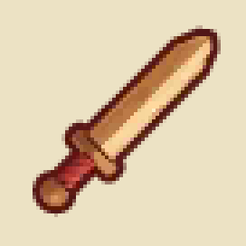
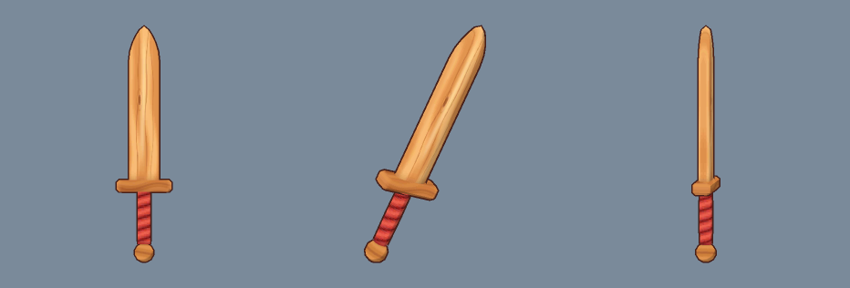

# Fantasy Life content workflow

Use the [tool command reference](../tools/README.md),
[archive specification](phase1-archive-formats.md) and
[table guide](phase1b-data-tables.md) for the established extraction/edit/rebuild
workflow. Original dumps/extractions stay unchanged; use separate ignored output
directories and isolated save profiles. Never commit derived game resources.

## Existing workflow

1. Identify the resource ID and table schema, and record the base revision.
2. Dump SCR to JSON with `tools/fl_scr.py`, edit row values while retaining control
   records/unknown fields, and rebuild. Update all parallel language/stat tables
   required by that family; do not infer that larger arrays are runtime-safe.
3. For archive-based builds, edit a separate extraction copy, rebuild with
   `tools/fl_archive.py`, re-extract into a fresh directory and validate cross-table
   references with `tools/fl_data.py validate`.
4. Run the edited content in an isolated native-port profile. Check acquisition,
   use, removal, transitions and save/reload, including existing content that shares
   IDs or category tables. Structural round trips and in-game tests are different
   acceptance steps.

Items/recipes are documented in Phase 1b; the walkthroughs below add an item, a shop
entry and a recipe, a door with an interior, and a new enemy with `tools/fl_mod.py`.
[Phase 2](phase2-maps-enemies.md) documents the map/enemy formats behind the last two. `fl_map.py` handles
placements and resource inventories; event-script authoring is separate work.
Structural editing is tested offline; gameplay acceptance still belongs to the user.

Increasing multiplayer beyond three requires coordinated game-code/storage and UI
changes; an SCR edit or UDS maximum alone is insufficient. See the
[four-to-six-player feasibility audit](multiplayer-six-players.md) before authoring
related content. No player-count overlay ships; the runtime's function hook registry and
native code-mod API can override game functions, but no such mod is part of the published
set (see [hooks.md](hooks.md)).

## Mods: source folder, build, enable, disable

The experimental [Free Life preset](story-skip.md) adds a localized new-game
Story Mode / Free Life choice through `mods/story-skip/`. It skips the base story
and Life introductions, credits their **8000 Bliss** using normal settlement,
and leaves Life ranks at Novice and Origin Island progression separate. It needs
no runtime hook. Use its fresh-save checklist; static
validation does not establish that every NPC or route is safe.

A mod is a **source folder** in this repo, `mods/<name>/mod.json` (human-editable row
edits; no game bytes, so it can be committed). `tools/fl_mod.py` turns it into a
**resource overlay** (derived game data: keep it local, never commit it) that the
native port loads on top of the untouched `_file_archive.bin`.

```sh
# build (~40 s); --replace overwrites an earlier build of an overlay
python3 -I tools/fl_mod.py build extracted/fl_eu/archive mods/wooden-sword \
    data/yw2-recomp/mods/fantasylife/wooden-sword --replace
```

`build` applies every edit to an in-memory copy of the extraction, refuses to grow the
item, category-stats or recipe tables (fixed counts in code.bin and save bit sets),
runs `fl_data.py validate` (all cross-table links, including shop item IDs), round-trips
each changed SCR, LZ11-compresses it and writes `overlay.json` + `resources/*.lz`.

When two source mods need different rows of the same SCR table, merge them in one
pass instead of shipping two overlays that collide on that table:

```sh
# sources apply in the given order; --replace rebuilds an earlier stack
python3 -I tools/fl_mod.py build-stack extracted/fl_eu/archive \
    data/yw2-recomp/mods/fantasylife/combined \
    mods/sword-a mods/sword-b --replace
```

`build-stack` loads the extraction once and applies `copies`, `edits`, `textures`,
`models`, `placements`, `transitions`, `scripts` and `files` from every source in
the specified load order. Different rows (and disjoint cells of one row), appends to
the same shop/loot/spawn/placement table, and different members of one named pack
merge. It stops with a named conflict when two mods give the same `(resource, row,
column)` incompatible values, or when both replace the same texture/model/file,
script, placement or table copy. `overlay.json` records the constituent mods in
`sources` (order, folder, SHA-256 digest of the source folder) and the assigned
symbols in `allocations`. Independent overlays are still not row-merged by the loader; keep
using `check-stack` for those.

Enable / disable (multiple overlays can be active together):

| Want | Do |
| --- | --- |
| Enable an installed overlay | Remove `data/yw2-recomp/mods/fantasylife/<name>/disabled` (or toggle it in the launcher's Mods tab). |
| Disable it | `touch .../mods/fantasylife/<name>/disabled` (or toggle it off). Rebuilding with `--replace` re-enables it. |
| Use one overlay for a single run only | `FL_MOD_DIR=<overlay folder> tools/fl-run.sh` (ignores `disabled`; unset `FL_MOD_DIRS` first). |
| Use several for one run | `FL_MOD_DIRS=<folder A>:<folder B> tools/fl-run.sh` (Linux path separator; ignores `disabled`). |
| Force all overlays off for a run | `FL_MOD_DIRS= tools/fl-run.sh` |

The log shows `FL mod: <name> (N resources, …) from <folder>` when an overlay is active.
Overlays load in canonical folder-path order. `FL_MOD_DIRS` takes precedence over
`FL_MOD_DIR`; without either variable, all enabled folders are loaded. Every overlay
must target the same base archive. A shared physical resource ID is a fatal conflict
naming both folders, even when the proposed bytes match. Named-pack member edits
conflict at their rebuilt parent pack. Check before launch:

```sh
python3 -I tools/fl_mod.py check-stack \
  data/yw2-recomp/mods/fantasylife/castele-house \
  data/yw2-recomp/mods/fantasylife/wooden-sword
```

This detects conflicts; it does not row-merge independent overlays. Use
`build-stack` for source mods that need different rows of one shared table.
Use a copy of your save folder for modded play (`YW2_STATE_DIR=...`); a save holding a
modded item shows the reused row's original placeholder when the mod is off.

### Native code mods (advanced)

An enabled overlay folder can also carry a native plugin (`mod.dll` on Windows, `mod.so`
on Linux/macOS). The runtime loads it only with `FL_NATIVE_MODS=1`, hashes the binary into
the multiplayer compatibility digest, and passes the `FLModAPI_v1` table from
`modding/native/include/fl_mod_api.h`. Plugins can read/write guest memory, call guest
functions, register before/after/replace hooks on recompiled addresses, register
Level-5 script-native opcode handlers, add frame/init callbacks, register a
compatibility tag and log. They are trusted local code: do not enable a plugin whose
source or author you do not trust. Lifecycle and a minimal example are in
[hooks.md](hooks.md); resource overlays remain the portable, version-checked path for
ordinary content.

### `mod.json` format (`fl-mod-source-v1`)

The revision-specific `"story_skip": {"version": 1}` operation runs
`tools/fl_story_skip.py`. It derives terminal flags from the shipped SYS003
completion switch, checks pinned base hashes, inserts authored VM instructions
with branch/global relocation, and edits only two unused system-message pairs
in each of nine language banks. This is a narrowly audited preset rather than
a general save-state editor. All generated scripts/messages remain private.
Two overlays touching its shared script **21172**, opening **27060**, or message
banks conflict normally. With current main sources, Free Life (11), Wooden Sword
(53) and Quiet House (22) form an **86-resource** disjoint stack.

Progression changes made by scripts persist in the save after an overlay is
disabled. Keep Free Life enabled for those saves until their current Life is
Fledgling: its guild exception permits Life changes while still Novice. Use a
separate state directory, not an existing campaign. See the design for the exact
flags, achievement bits and audit command.

```json
{"format": "fl-mod-source-v1", "name": "Wooden Sword",
 "edits": [
   {"resources": [6792, 6793, ...], "row": 77, "copy_from": 0,
    "expect": {"category": 0, "icon_index": 1},
    "set": {"buy_price": 150},
    "localized": {"name": ["木の剣", "Espada de madera", ...]}},
   {"resource": 8405, "row": "append", "copy_from": 3, "set": {"item_id": 77}}],
 "textures": [{"resources": [16487], "png": "art/icon.png"},
              {"resource": 4123, "base": 3805, "png": "art/sword_texture.png", "format": "etc1"}],
 "models": [{"resource": 4122, "base": 3804, "mesh": "art/sword_mesh.json"}],
 "files": {"12345": "my_texture.ztex"}}
```

- `resource` / `resources`: SCR resource IDs the edit applies to (all language slots of
  a family; slot order ja, es, fr, de, en, es, fr, it, en-GB, see Phase 1b).
- `row`: row index to overwrite, the next row index, or `"append"` (including item,
  category-stat, recipe and shop tables). `copy_from`: start from a deep copy of this row (keeps unknown columns and
  bytes), default the row itself.
- `expect`: values the target row must have *before* the edit; the build stops if the
  base data differs (guards against reusing a row that is not what you think).
- `set`: column values for every listed resource; `localized`: one value per listed
  resource, in the same order. Column names are those of `tools/schemas/*.json`.
  Strings may contain control tokens, e.g. a line break `{"control": "f0ffffff04000000"}`.
- `textures`: ZTEX resources built from your own PNG. `base` (default: the target itself)
  is the container template: image names, flags and dye-colour records are kept and every
  image is replaced by the PNG (`format`/`mips` default to the base image's; model textures
  may change size, icons (`icn_*`) may not: the UI draws them in fixed cells).
- `models`: ZMDL resources built from a `base` model (skeleton, attachment bones, material)
  whose mesh geometry is replaced by a standard glTF 2.0 binary file (`glb`: `"art/model.glb"`),
  or a legacy mesh JSON (`mesh`: `"art/mesh.json"`, `fl-mesh-v1`), and/or whose material texture
  references are renamed (`texture_names`: `{old: new}`). Skinned meshes map vertex weights onto
  donor bones and automatically split into face groups if bone palettes exceed 20 bones; rigid
  meshes can specify `bone` (e.g. `"R_tool"`) and `up` (`"z"` or `"y"`). Outline normals are
  computed automatically. See
  [Custom icons, textures and models](#custom-icons-textures-and-models) and
  [How to add a new enemy](#how-to-add-a-new-enemy).
- `files`: whole non-table resources (ID or extracted path → file in the mod folder).
  Named pack members are rebuilt into their pack automatically. New standalone physical
  IDs may be added contiguously from the base archive count (58,095 for EU v00), through
  65,534. `textures` and `models` may target these IDs with an explicit existing `base`;
  raw `copies` may also target a new ID. Resource 1 is maintained by the runtime.

### Appended items and recipes

To reserve new rows instead of dummy slots, use an explicit append allocation:

```json
{"allocate": {"weapon": {"symbol": "$sword", "append": true},
              "alchemy_recipe": {"symbol": "$recipe", "append": true}}}
```

The item symbol and `.stat_row` identify the new item and category-local stat row.
Append complete rows with `edits` and `copy_from` in all nine slots of each of
6702, 6792, 6801 and 6810, then append the corresponding nine stats rows using
`.stat_resources` and `.stat_row`. For a weapon, copying row 0 preserves category 0;
for other categories choose a donor of that category. Recipe edits use the recipe
symbol as the row in its Life table. `append:true` also supports `furniture`,
`key_item` and `bounty`; select a specific Life for appended recipes.
Allocation reserves indices; the edits supply the complete donor-based rows.
Literal row indices or `row:"append"` work too. The builder rejects mismatched
language counts/categories, missing stats, shrunk vanilla tables and ID gaps.
Use `build-stack` to assign appended symbols across several mods in source order.

### Symbolic IDs and automatic dummy slots

Do not hard-code an unused row/icon/model slot if another mod may also use it. Declare
the reservations once in `allocate` and use the symbols everywhere in that source:

```json
{"format": "fl-mod-source-v1", "name": "My Sword",
 "allocate": {"weapon": "$my_sword", "item_icon": "$my_icon",
              "weapon_appearance": "$my_model_slot", "carpentry_recipe": "$my_recipe"},
 "edits": [
   {"resource": 6702, "row": "$my_sword",
    "set": {"symbolic_id": "ID_Item_MySword"}},
   {"resource": 6792, "row": "$my_sword", "copy_from": 0,
    "set": {"name": "My Sword", "icon_index": "$my_icon", "buy_price": 500}},
   {"resource": 6720, "row": "$my_sword.stat_row", "copy_from": 0,
    "set": {"attack": 30}},
   {"resource": 8405, "row": "append", "copy_from": 0,
    "set": {"stock_tier": 1, "item_id": "$my_sword"}},
   {"resource": 8390, "row": "$my_recipe", "copy_from": 14,
    "set": {"output_items": ["$my_sword", 65535, 65535, 65535],
            "rank_requirement": 2, "unlock_rank": 2}}],
 "textures": [{"resources": "$my_icon.texture_ids", "png": "art/icon.png"},
              {"resource": "$my_model_slot.texture_id", "png": "art/texture.png"}],
 "models": [{"resource": "$my_model_slot.model_id", "mesh": "art/mesh.json"}]}
```

- Pool names: `weapon`, `armour`/`armor`, `tool`, `consumable`, `material`
  (20 verified `ID_Item_<kind>_dummy*` rows per category in 6702); `item_icon`
  (an unreferenced `icn_itm` icon row with its own texture); `weapon_appearance`
  (`配信用ダミー` weapon appearances in 8714 plus their model/texture resources) or
  `gear_appearance`/`appearance` for any gear dummy (armour, shields, tools);
  `alchemy_recipe`, `blacksmith_recipe`, `carpentry_recipe`, `cooking_recipe`,
  `tailoring_recipe` (rank-16 filler rows), or `recipe` for any of the five tables.
  Use `"auto"` or `true` instead of `"$name"` to generate a symbol; a list allocates
  several slots. Allocation is deterministic first-free and never reuses a slot
  already taken earlier in the same `build`/`build-stack`.
- `$my_sword` resolves to the item ID; also `.item_id`, `.category`, `.stat_row`,
  `.stat_resources`. `$my_icon` resolves to the icon row; `.texture_ids` is the list
  of icon texture resources (usually one; write your PNG to all of them) and
  `.texture_id` is available when there is exactly one. `$my_model_slot` resolves to
  the appearance row; `.model_id`/`.texture_id` are its resource pair and
  `.appearance_row` is the row. `$my_recipe` resolves to the recipe row; `.table` is
  its resource ID and `.recipe_key` its current filler key.
- Symbols are local to their source, but a later source in `build-stack` can reference
  an earlier source's symbol when it does not declare the same name. Every allocated
  dummy row is verified before use, and `build`/`build-stack` inject the matching
  `expect` guards automatically; do not duplicate them by hand.

## Lua script mods (no compiler, hot reload)

A mod folder can also carry **text scripts** instead of (or alongside) a resource
overlay. The port embeds a sandboxed Lua 5.4 interpreter; `script.lua` and
`scripts/*.lua` are discovered in every active mod folder and run when the game
starts. No compiler, shared library or `FL_NATIVE_MODS` opt-in is needed.

```lua
-- mods/my-script/script.lua or mods/my-script/scripts/example.lua
fl.log("my script loaded")

local handle = fl.hook_before(0x00123450, function(ctx)
  ctx:set_r(0, ctx:r(0) + 1)
end)

fl.on_frame(function(frame_index)
  if frame_index % 60 == 0 then fl.log("frame", frame_index) end
end)
```

Addresses are guest (recompiled) addresses; find them with the tools in `tools/re` and
the names in `tools/re/symbols_fl_eu.txt`. The API provides:

- `fl.log`, `fl.warn`; `fl.read_u8/u16/u32/f32`, `fl.read_bytes` (nil when unmapped);
  `fl.write_u8/u16/u32/f32` (false when unmapped).
- `fl.hook_before/hook_after(addr, fn)` and `fl.hook_replace(addr, fn)`; a replacement
  receives `(ctx, call_original)` and can decline by returning `false`. `ctx:r(i)`,
  `ctx:set_r(i, value)`, `ctx:sp()` and `ctx:lr()` expose the guest registers.
- `fl.unhook(handle)`, `fl.on_frame(fn)` and `fl.call_guest(addr, ctx_table)`.

Scripts are sandboxed: `io`, `os`, `package`, `debug`, `dofile`, `loadfile` and
`require` are absent, so they cannot read/write arbitrary files, run processes or load
native code. `print` is routed to the log. A broken script or callback logs
`[FL Script Mod <mod>/<file>] error: ...` and unregisters only that callback; the game
keeps running.

Discovery order is the active mod order (`FL_MOD_DIRS` order, otherwise enabled mod
folder names), with `script.lua` first and `scripts/*.lua` sorted by filename. A folder
without `overlay.json` is a valid script-only mod. Press **Ctrl+R** (Cmd+R on macOS)
in game, or call `mods::reload_scripts()`, to remove all script hooks and reload the
files from disk without restarting. The full API, runtime limits and thread rules are
in [hooks.md](hooks.md).

## How to add a new item, sell it in a shop, add a recipe

Worked example: `mods/wooden-sword/mod.json` (the Wooden Sword). Inspect tables with
`python3 -I tools/fl_scr.py dump extracted/fl_eu/archive/_unnamed/<ID>_*.scr /tmp/x.json`.

1. **Pick an item ID without shifting anything.** Item ID = row index in every
   item-parallel table and category blocks are contiguous. There are two safe choices:
   - **Append past 2,734 with the port's extended-item runtime** (`fl_extended_items`,
     default on). Append the real category byte after row 2,734 in all 36 item-parallel
     tables plus the matching stats family; vanilla IDs and category-local indices stay
     unchanged. The runtime maps appended IDs to `vanilla size + appended ordinal` and
     keeps extended save state in `fl-items.sidecar`; see
     [phase1b-item-expansion.md](phase1b-item-expansion.md). This is offline-tested but
     not yet boot-tested.
   - **Without the extended-item runtime, reuse an unused placeholder** inside the right
     category block: their symbols are `ID_Item_<kind>_dummyNNNNNN` in table 6702 and
     names `ぶき`/similar Japanese placeholders. There are **20 per category** for weapons
     (58–77), armour, tools, consumables and materials; none for furniture, key items or
     bounties. Confirm nothing references the row (`fl_data.py validate` lists
     recipe/quest/shop/drop links; the Wooden Sword uses 77 =
     `ID_Item_weapon_dummy000020`, referenced nowhere).
2. **Copy a similar real item** into it in all item-parallel families, using
   `copy_from` so icon, sub-type, equip data and flags come along:
   - `6702–6710` symbol (`symbolic_id`, rename the dummy symbol);
   - `6792–6800` name + base data (`name` localised, `buy_price`, `sell_price`,
     `icon_index`; `category`/`item_type` come from the template);
   - `6801–6809` acquisition/authoring text (Japanese authoring tags; not localised);
   - `6810–6818` description (localised; copy the line-break controls of the template's
     slot, English slots use a bare `f0` break, the others `ffff` + `f0`);
   - the **category stats** family at the same category-local index: weapons
     `6720–6728` (`attack`; `u_0a` is the model/appearance index, 613 = Squire's Sword
     model), armour `6729–6737`, … (Phase 1b). For weapons the category-local index
     equals the item ID (the weapon block starts at 0). For an appended row the stat row
     is `vanilla category size + appended ordinal`, and the stats table must grow too.
3. **Icon/model.** Keep the template's `icon_index` and weapon `u_0a` to reuse its
   icon and model, or point them at free slots and give them your own art: the Wooden
   Sword uses icon row 1879 and weapon appearance 1580 (see
   [Custom icons, textures and models](#custom-icons-textures-and-models)).
4. **Sell it in a shop.** Shop stock lists are resources **8405–8483** (`shop_inventory`
   schema, 8-byte rows `<u16 stock_tier, u32 item_id>`): 8405 = Castele weapon & armour
   shop (its items' authoring text is `クルブルク 武器と防具の店`), 8414 = lumber/Carpenter
   goods (Oak Log…), 8462 = a later full sword shop. Append a row copied from an existing
   one; `stock_tier` 1 = initial stock, 2 = later stock. The price comes from the item.
5. **Add a recipe.** Recipe tables 8388 alchemy, 8389 blacksmith, **8390 carpentry**,
   8391 cooking, 8392 tailoring cannot grow (save bits per row). Overwrite a filler row:
   rows with `rank_requirement = 16` and `unlock_rank = 16` are never learned, e.g. the
   66 duplicated `Barrel` rows at the end of carpentry (163–228). Copy a real recipe of
   the same bench/category (`copy_from`; the Wooden Sword copies Oak Staff, row 14:
   `workbench` 25, `category_icon_index` 4602, difficulty/experience/timing) and set
   `output_items` (4 quality tiers, 65535 unused), `ingredients` + `ingredient_quantities`,
   `rank_requirement`/`unlock_rank` (2 like the other Oak gear), a unique `recipe_key`
   and `category_tags` (swords/bows use `[0, 11]`, staves `[1]`). Use `expect` to pin the
   filler row's old values.
6. **Build, enable, test** (above). Report what the game shows using a
   `docs/testing/<topic>.md` checklist; in-game testing is done by the user.

Open points for bigger equipment work: meaning of `item.variant`, `tier`, the `flag_*`
bits, most weapon/armour stat columns and the recipe `u_*`/`work_parameters` columns; how
recipes are granted (rank-up event vs. computed from `unlock_rank`);
more than 20 items per category needs native support for a larger item count and save
migration (see Phase 1b, *Appending items and hard-coded limits*).

## Custom icons, textures and models

Tools: `tools/fl_ztex.py` (ZTEX textures), `tools/fl_zmdl.py` (ZMDL models) and the
`textures`/`models` sections of `mod.json`. Worked example: the Wooden Sword's art in
`mods/wooden-sword/art/` (procedural painting/mesh scripts and their PNG/JSON output, all
our own work; the build combines them with base resources from your extraction).




### Where the game looks

- **Item icons.** `items.icon_index` → icon table row (8686–8694) → its `icon_id` is the
  **archive resource ID of a one-image ZTEX**, 64×64 ETC1A4 (Squire's Sword: row 1814 →
  16418 `icn_itm401_0001_10default`). There is no shared atlas; resource 8695 is a map
  spawn index. Equipment icons are followed by six unreferenced dye variants at
  `icon_id+1…+6` (`_20black`, `_30white`, `_40red`, `_50green`, `_60blue`, `_70yellow`).
- **Icon families decide the on-screen cell, not the texture header.** The name prefix
  (`icn_itm`, `icn_cmd`, `icn_crf`, …) is the family; the UI draws every icon of a family
  in that family's cell. All 3,406 `icn_itm` icons (every item uses one) are 64×64;
  command prompts `icn_cmd` are 128×32, crafting `icn_crf` 32×128, furniture `icn_fnc`
  64×32, Happy-shop `icn_hpi` 128×128. **An item icon must use an `icn_itm` slot.** The
  first Wooden Sword build used the "Unused" command slot 4542 (`icn_cmd029`, a 64×64
  placeholder): in game it came out squashed into a wide strip. `fl_mod.py` now refuses
  item icons from other families and icon replacements of a different size.
- **Free item icon slots.** Six `icn_itm` rows are referenced by no item or recipe and
  own their texture: 1825 (16435, Vagabond Sword), 1879–1882 (16487–16490, cut daggers
  `# Crystal knife` …) and 1909 (16524, cut bow). The Wooden Sword uses row 1879 and
  writes its icon into 16487–16490 (cut daggers have no dye variants, so a dye offset
  would land on these neighbours).
- **Weapon models.** `weapon_stats.u_0a` is a row of the appearance tables 8714 and
  8678–8685 (nine language slots, 1,621 × 24 bytes; `c01` = Japanese name). Its pointer
  `c00` leads to `<u32 0x01200000, u32 model ID, u32 0x01000000, u32 texture ID,
  u32 0xffffffff, UTF-16 name>`. Row 613 兵士の剣 (Squire's Sword) = model 3804 /
  texture 3805. **Rows named `配信用ダミー・…` are unused DLC dummies** with their own
  model/texture resources: one-handed swords 1576–1580 (片手剣 6–10), two-handed swords,
  daggers, bows, wands, shields, tools and clothing. The Wooden Sword uses 1580
  (model 4122, texture 4123). Byte 0x17 bit 3 of a row is set on released gear and clear
  on dummies/cut items (meaning unknown, maybe dye support); it is left unchanged.
- **Binding.** A weapon ZMDL's material names its texture (`av_weapon_ss_108`), but the
  shipped 修練の片手剣 pair (4112/4113) has non-matching names, so the loader does not
  rely on names. Keep the base texture container (`base` in `textures`): its names,
  order and the 7 dye-colour records stay as the game expects.

### ZTEX (`tools/fl_ztex.py`)

```sh
python3 -I tools/fl_ztex.py info   extracted/fl_eu/archive/_unnamed/03805_*.tex
python3 -I tools/fl_ztex.py decode extracted/fl_eu/archive/_unnamed/16418_*.tex /tmp/icon.png [--image N] [--mip N]
python3 -I tools/fl_ztex.py encode my.png /tmp/my.ztex --name tex_name --format etc1a4 [--mips 2]
python3 -I tools/fl_ztex.py replace base.ztex my.png /tmp/out.ztex [--image N]
```

`'ztex'`, u16 image count, u16 flags (bit 1: an extra-record count follows at 0x08, bit 0:
4 extra bytes before each entry), then one **0x58-byte entry** per image (Kuriimu2's
`EntrySize_ = 0x56` constant is wrong; Ohana reads 0x58): name[0x40], CRC32(name),
data offset, 0, data size, u16 width/height, u8 mip count, u8 format, u16 0x00ff. Then the
extra records (8 bytes each; weapon textures carry 7 = the dye colours), image data
aligned to 0x80, mips following each image. Formats 0x01 RGB565, 0x03 RGB8, 0x05 RGBA4,
0x07 RGBA5551, 0x09 RGBA8, 0x0b L4, 0x0d LA4, 0x11 A8, 0x13 L8, 0x15 LA8, **0x18 ETC1,
0x19 ETC1A4** (icons, most models). Pixels are 8×8 Morton tiles; ETC blocks are 4×4 in
2×2 Z order per tile, little-endian, ETC1A4 with 4-bit alpha first. PNGs show the image
**as the game displays it** (first stored row = top; checked against an in-game
screenshot: weapon icons have the handle bottom-left), and model UVs then use the usual
**v = 0 at the bottom** of the PNG. The ETC1 encoder is our own
(least-squares base refinement + neighbourhood search; re-encoding game textures gives
45–56 dB). Hard light/dark edges inside one 4×4 block show a few specks, as in the
originals; painting a mid-tone rim inside outlines keeps them invisible.

### ZMDL (`tools/fl_zmdl.py`)

```sh
python3 -I tools/fl_zmdl.py info   extracted/fl_eu/archive/_unnamed/03804_*.mdl
python3 -I tools/fl_zmdl.py obj    extracted/fl_eu/archive/_unnamed/03804_*.mdl /tmp/sword.obj
python3 -I tools/fl_zmdl.py gltf   extracted/fl_eu/archive/_unnamed/03804_*.mdl /tmp/sword.glb \
    --ztex extracted/fl_eu/archive/_unnamed/03805_*.tex --up z
python3 -I tools/fl_zmdl.py gltf   extracted/fl_eu/archive/unit/mon/mon004/0001/model/mon004_0001.mdl \
    /tmp/red_wolf.glb --ztex extracted/fl_eu/archive/unit/mon/mon004/0001/model/mon004_0001.texa --up y
python3 -I tools/fl_zmdl.py import-glb donor.zmdl custom.glb out.zmdl [--bone R_tool] [--up z]
python3 -I tools/fl_map.py  gltf   extracted/fl_eu/archive 150 /tmp/general_goods.glb
python3 -I tools/fl_zmdl.py render extracted/fl_eu/archive/_unnamed/03804_*.mdl \
    extracted/fl_eu/archive/_unnamed/03805_*.tex /tmp/sword.png --yaw 35 --pitch 20
```

Version 3 layout (Ohana's importer plus our checks over all 4,442 v3 models): header
(bound floats, material/bone/mesh tables), 0xb4-byte materials (texture reference with
UV matrix and CRC32), 0xcc-byte bones (including row-major local matrix and inverse bind
matrix), 0xc4-byte meshes with nine attribute descriptors (position, normal, colour,
uv0–2, bone index, weight, **outline normal**: a smooth per-position normal used for the
inverted-hull outline), 0x14-byte face groups (bone palette of up to 20 bones, u16
triangle-list indices). All vertex buffers follow the metadata, then all index buffers,
4-byte aligned, nothing after them.

**Blender glTF 2.0 workflow (`.glb`):**
- `fl_zmdl.py gltf`: Exports any ZMDL to standard glTF 2.0 `.glb` with bone hierarchies,
  inverse bind matrices, multi-material primitives, UVs, vertex colors, and skinning
  attributes (`JOINTS_0`, `WEIGHTS_0`). Textures from `.tex`/`.texa` files are decoded and
  embedded as PNGs so they open textured immediately in Blender. Use `--up z` for weapons
  and tools (blade along +z upright in Blender), `--up y` for units, monsters, and maps.
- `fl_zmdl.py import-glb`: Imports geometry from Blender `.glb` into a donor ZMDL. Skinned
  vertices map onto donor bones and automatically split into face groups if exceeding the
  20-bone palette limit. Rigid models map onto their attachment bone (`--bone R_tool`).
  Smooth outline normals (attribute 8) are computed automatically.
- `mod.json` supports `"models": [{"resource": 4122, "base": 3804, "glb": "art/sword.glb"}]`.

### Making art in the game's style

- **Icons:** 64×64 `icn_itm` slot, item drawn on the 45° diagonal (handle bottom-left,
  tip top-right, like every weapon/tool icon), ~2 px outline in dark maroon
  `(84, 22, 24)`, one lit and one darker long edge as in the originals (decode one with
  `fl_ztex.py` and copy its shading), a darker 1 px line where parts overlap, few soft
  colour bands. Paint at 4× and box-filter down (see
  `mods/wooden-sword/art/paint_icon.py`); ETC1A4 keeps 16 alpha levels.
- **Model textures:** painted albedo, broad soft bands and a few flowing strokes rather
  than fine noise (compare the Oak Staff 3662 and Oak Bow 3674 textures); the game's cel
  lighting adds the form shading. 64–128 px, ETC1, regions padded by ≥4 px.
- **Geometry:** low poly, rounded silhouettes, matching the Squire's Sword's scale
  (about 10 units from pommel to tip). The Wooden Sword mesh has 344 vertices /
  464 triangles (Squire's Sword: 66 / 44).
- **Previews:** `python3 -I mods/wooden-sword/art/make_previews.py extracted/fl_eu/archive
  <built overlay> docs/assets/wooden-sword` renders what the overlay contains, resolving
  the icon the way the game does (item table → icon table → texture) and checking its
  family/cell. Its
  `compare-*.png` sheets include original game art and are git-ignored: never commit them.

## How to make a door and a custom interior

Worked source: [`mods/castele-house/mod.json`](../mods/castele-house/mod.json).
The overlay is built and validated offline; gameplay acceptance is pending in
the house checklist. Follow
[Phase 2's resource inventory](phase2-maps-enemies.md#concrete-slice-a-closed-shopping-district-door--custom-room)
and [Phase 1c's activation trace](phase1c-scripts.md#applying-this-to-shopping-district-door05--spare-map-154).

1. **Reserve the identity.** Shopping District is map **0**; its closed
   `map_001_door05` is in model **8748**. Spare **map 154 / HouseMap_019** has
   bundle **120**, empty placements **21323/21324** and an audited exit-only stub
   script **21314** (21313 is text). Keep **8697 row 110** and its script resources.
   New NPC/event content needs another script audit.
2. **Copy one coherent room.** The attic plan is suitable for an empty shell;
   this slice instead uses furnished **Steele's House, map 159 / bundle 125**.
   `copies` transfers its nine complete resources into bundle 120's reserved IDs:
   model **9047 → 9002**, collision **9042 → 8997**, material animation
   **9043 → 8998**, textures **9048 → 9003**, motion **9049 → 9004**, camera
   **9041 → 8996**, FB **9046 → 9001**, GB **9045 → 9000**, opaque companion
   **9044 → 8999**. Bundle row 120 copies row 125, including its opaque variant
   pointer/related value, while keeping the reserved resource IDs. No donor asset
   is modified. Baked furniture, collision and lighting stay together. Slot 6 has
   no minimap, as in the donor; do not borrow outdoor minimap tiles.
3. **Localise the map.** In **5966–5973**, row 154 copies donor row 159's room,
   camera and BGM **54/54**, but keeps `HouseMap_019`, bundle 120, script row 109
   and its original `u_40=154`. Names cover all eight Western slots in order:
   es-419, fr-CA, de, en, es, fr, it, en-GB. There is no Japanese slot in this
   eight-table family. The new name is **Quiet House**, translated per slot.
4. **Pair the door and exit.** Append **route 218** in **5965**, copying route 5
   (ordinary Shopping District door), changing endpoints to `[0,154]` and door
   selectors to `[5,255]`. All original routes remain intact. In **22761**, append
   a type-3 clone of row 7, fresh UID **0x04000ffe**, enabled and unlinked.
   The door's rotation is about -48.5°; derive its centre from its actual mesh,
   then offset along rotated +Z. Trigger **(-0.297,1.51,-13.038)**, return landing
   **(-0.806,1.51,-12.588)**, trigger yaw **2.2951**, return yaw **5.4367**.
   These positions need user confirmation against collision.
5. **Author the room's exit.** `placements` starts **21323** from the complete
   attic **21399** document, remaps map/group to **154**, UID **0x044d0ffe** and
   route **218**, then uses the furnished donor's threshold/arrival geometry:
   exit **(0,0.05,5.2)**, arrival **(0,0.06394,3.2)** facing into the room.
   Correct empty **21324**'s map group from 98 to 154 too. The house donor's
   NPCs and event triggers are not copied. 22761 and 21323 are unconditional
   baseline layers, so no extra script or night-layer clone is required.
6. **Build, check and hand off.** `fl_mod.py` verifies the explicit paired
   `transitions` check and round-trips the generated placement files. Run all
   Python unit tests and `fl_script.py check`, then use the native offline
   archive probe for stacking. The user tests entry, opening animation, furniture,
   collision, return, minimap/name, day/night and save/reload; never boot the game
   as an agent.

```sh
python3 -I tools/fl_mod.py build extracted/fl_eu/archive mods/castele-house \
  data/yw2-recomp/mods/fantasylife/castele-house --replace
```

Additional source keys (no game bytes or relocation offsets in mod sources):

- `copies`: `[{"resource":9002,"base":9047}]` copies a complete resource from the
  verified extraction. Between two schema-backed tables of the same schema the copy is
  a table document (e.g. a monster's battle parameters into a reserve leaf) that row
  `edits` then modify; see [How to add a new enemy](#how-to-add-a-new-enemy).
  Copies read the original extraction, not another operation's generated output.
- `placements`: each entry has `resource`, optional donor `base`, `edits`, optional
  `map_groups`, and explicit `experimental_growth:true` for appends/group changes.
  An edit has `row` (index or `"append"`), append-only `copy_from`, `expect`, `set`
  for record fields, and optional `warp`/`spawn` payload fields. The builder
  relocates a cloned payload before editing it, preserving the original endpoint.
  It rejects duplicate UIDs, stale expectations and pointer/type/index edits.
- `transitions`: `[{"route":218,"endpoints":[{"resource":22761,"uid":67112958},
  {"resource":21323,"uid":72159230}]}]` checks two enabled/unlinked type-3 UIDs,
  matching route map IDs, map groups, trigger sizes and associated placement layers.
- `scripts`: `[{"resource":12345,"assembly":"script.fls"}]` assembles source with
  `fl_script.py` and checks a disassembly/assembly round trip. This house needs no
  VM patch: its stub supports an exit-only room. Script/source paths stay in the mod
  directory; all generated resources remain private.

**Limits:** ordinary route lookup/arrival uses SCR rows dynamically, but script
native **134** (`route_select`) and scripted route travel still reject 218. The
house invokes neither. Full route/save acceptance and opening selector **5** are
pending user checks. This is a donor-layout room with a new connection/name,
not a new modelling, resident, quest or decorating system. No live route is reused.

## How to add a new enemy

Worked source: [`mods/eastern-plains-enemy/mod.json`](../mods/eastern-plains-enemy/mod.json),
the **Thistle Wolf**, a Red Wolf variant with its own coat, name, stats and drops in
East Grassy Plains. Gameplay acceptance is pending in
its checklist; formats and evidence are in
[Phase 2](phase2-maps-enemies.md#concrete-slice-b-custom-red-wolf-variant-in-east-plains).


How the game finds a monster: a placement **type-12 region** (where, how many, which
points) references a row of the area's **spawn-group table** (map → table through
**8695**; East Grassy Plains, map **25**, uses **7290–7298**). The group lists
**monster IDs** with weights. A monster ID is a row of **6920/6940–6947**, whose
`unit_index` is a row of the **unit tables 8706–8713/8719**: 17 resource IDs (model,
texture, motions, actions, battle parameters, AI, effects, sounds) and the **name the
player sees**. 6940–6947 hold identical developer names (`Haneruti`, `Killer bunny`), not
the displayed ones. Drops are a block in **6930**.

1. **Reserve an identity.** The monster count (275) is a code literal
   (`0x332980`, `0x3226c0`), so reuse a reserve row instead of appending: **monster
   274** (`Dummy S-2-3`, unit **1406**) is spawned by no shipped group. Its own
   resources live in named pack **51122** (`unit/mon/mon078/0003/…`), used by nothing
   else, so its leaves can take new content without touching a real monster.
2. **Copy the donor's rows.** `copy_from` the Red Wolf: monster row 11 → 274 (keep
   `unit_index` 1406; names in the 9 slots), unit row 12 → 1406 (localised names in
   slot order es-419, fr-CA, de, en, es, fr, it, en-GB, ja). Point its `resources` at
   the wolf's motions, actions, AI, effects and sounds, except slot 0 (model) →
   **51120**, slot 2 (texture) → **51121** and slot 8 (battle parameters) → **51131**,
   the reserve's own leaves.
3. **Own stats: copy a whole table.** `"copies": [{"resource": 51131, "base": 46401}]`
   gives the reserve leaf the Red Wolf's complete battle-parameter file (all rows and
   preserved bytes); donor and target must share a schema. Then edit it with ordinary
   row edits (`"resource": 51131, "row": 0`): `hp`, attacks and defences at level key 1
   (key 100 rows are the endgame endpoint), `u_68` (scales with HP, most likely the XP
   reward) and `u_40` (likewise, maybe Dosh). Keep the other fields. The placement's
   level byte stays 1, as in all ordinary East plains regions.
4. **Own look: own model and texture leaves.** Shipped re-skins never share a model
   resource between units with different textures; each unit has its own model and
   texture resource (e.g. *Possessed Dogu*, unit 1250, whose model even keeps another
   monster's texture name: binding is by slot, not by name). Do the same:
   `models` `{"resource": 51120, "base": 46390, "texture_names": {"mon004_0001_001":
   "mon078_0003_001"}}` copies the wolf model into the reserve's model leaf and points
   its material at the reserve's own texture name; `textures` `{"resource": 51121,
   "base": 51121, "png": …}` keeps the reserve's container (that name, ETC1 128×128,
   2 mips) and encodes your PNG. The PNG must follow the donor model's UV layout. `art/paint_texture.py` bakes every texel's
   3D position from the wolf model and paints the coat as a function of the body
   (seamless, symmetric); `art/make_previews.py` renders what the built overlay
   contains: `fl_zmdl.py render --up y` previews units (y up, facing +z).
5. **Drops.** Append the monster's loot rows to **6930** (`copy_from` the donor's
   level 1 and level 100 rows, set `monster_id` and items). Thresholds are bytes out of
   255: 77 ≈ 30%, 51 ≈ 20%, 39 ≈ 15%, 26 ≈ 10%, 13 ≈ 5%, as in the shipped table;
   `bounty_item` 0xffffffff for none. **The builder keeps the loader contract:** blocks
   must be contiguous and ascending by monster, then level key, and a changed table
   gets exactly one terminator row (`monster_id` 0xffff, no drops). 0x332904 reads
   the monster ID of the row after each row; without the terminator a new last block
   (272–274) would end wherever the bytes after the table say.
6. **Spawn group.** Append a row to all nine 7290–7298 slots (`copy_from` 15, the
   shipped "Coyote or Red Wolf [30%]" pack): `monsters` `[274, 11, 65535…]`, `weights`
   `[40, 60, 0…]`. Row lookups are bounds-checked against the table's own count, so
   appending is safe. The label is only authoring text.
7. **Place it.** `placements` appends a type-12 region (`copy_from` a region with the
   same number of points; arrays cannot be resized) with a **fresh UID** (next ordinal
   of that layer's type-12 UIDs: 23053 `0x040cb024`, 23055 `0x0c0cb026`), `reference`
   = the new group, a position on walkable ground, and the points. A point with
   `flags` 4 forces group member `variant`; the others roll by weight. Add the new row
   index to the map group's `choice: -1` list (`map_groups`), or it never spawns, and
   build with `experimental_growth`. **Layers:** for a normal map the first placement
   file (23053) spawns by day and the second (23055) at night (time slot 3, see
   0x3d65d0); put the region in both for a day-and-night monster. 23054/23056 replace
   them only while event flag 2162 (Paladin "Trial of 12") is active.
8. **Check and build.** `fl_mod.py build` validates monster → unit links, spawn-group
   monster IDs, and for every type-12 region in an edited placement file: group in
   range, forced members inside the group, `min ≤ max ≤ points`, `max ≤ capacity`
   and map-group membership (all 107 shipped placement files with regions pass these
   checks). It round-trips every changed table and placement file.

```sh
python3 -I tools/fl_map.py monster extracted/fl_eu/archive 11 /tmp/wolf.json   # donor IDs + loot
python3 -I mods/eastern-plains-enemy/art/paint_texture.py extracted/fl_eu/archive \
  mods/eastern-plains-enemy/art/thistle_wolf.png
python3 -I tools/fl_mod.py build extracted/fl_eu/archive mods/eastern-plains-enemy \
  data/yw2-recomp/mods/fantasylife/eastern-plains-enemy --replace
python3 -I mods/eastern-plains-enemy/art/make_previews.py extracted/fl_eu/archive \
  data/yw2-recomp/mods/fantasylife/eastern-plains-enemy docs/assets/eastern-plains-enemy
```

`make_previews.py` also prints the resolved names, stats, drops and regions and draws
`location.png` (top-down terrain of map 25 with the regions); every image except
`texture-4x.png` shows the game's model or map and is git-ignored.

**Choosing a spot.** There is no navmesh tool yet. Pick flat ground from the area's
terrain model (the preview's top-down renderer samples it; the Thistle Wolf stands
where the terrain is flat at y = 2.0) away from other regions and gathering points,
and let the user confirm it in game. **Not needed:** a monster-book entry (6921–6929
are untranslated cut data in the EU release) or a bounty (only for monsters that
drop a category-7 bounty item, then also **6783–6791**).

**Still open:** exact stat interpolation between level keys, the XP/Dosh fields,
the drop roll and respawn timing are inferred from data, not traced; AI rules
(`uparm02`), schedules (`uparm03`), actions and motions must stay compatible with the
donor, so a new species still needs a donor of the same skeleton.

### Packaging and validation for maps/enemies

Placement binaries are built from `placements` operations (or replaced via `files`);
schema-backed SCRs use `edits`, and `files` replacements of them stay rejected so
validation cannot be bypassed. A whole-table donor copy between resources of the same
schema is a `copies` entry (step 3 above), applied before the row edits; `copies` of
non-table resources copy raw bytes as before.

No new archive IDs are needed. `fl_data.py validate` checks item/recipe/shop/quest
links; `fl_mod.py` adds the monster/unit/spawn-group/loot and type-12 region checks
above, but not every relationship (e.g. linked UIDs of event layers). Experimental
placement growth proves reconstructed pointer indexes, not runtime capacity or
references from opaque scripts; the Quiet House's grown door layer works in game.

## Expansion prerequisites

The roadmap records the remaining authoring requirements and small
experiments for each feature. Its T1–T9 tooling track covers mod manifests/stable
IDs, scripts, debug/teleport/flag tools, save migration, models/textures/animations/
maps, UI layout, localisation/fonts, networking and renderer/performance checks.

New item IDs, Lives, ranks, flags and challenges can require native-code bounds
and serializer changes. New archive resource IDs also require the relationship
index. ZMDL viewing does not prove model export back into the game; a texture edit
does not prove a new animation or collision format. Establish one complete game
round trip of each required format before expanding a content pack.

For co-op content, review the roadmap's original restriction audit and require a
matching gameplay-content manifest on all peers. Relaxing a clerk's refusal is
not sufficient evidence that progression, time changes or persistence are safe.
The [co-op freedom audit](coop-freedom.md) lists every gate: script gates ask native 453
for the multiplayer role, and a visitor's `flag_set` lands in a transient copy of the host's
world flags, so anything that sets flags is host-only at best. The shipped lifts are runtime
hooks recognised by script bytes, so a mod that rewrites one of the gated scripts (21172,
21290, 21924, 21984, 21996, 22312, 22336, 22352, 22376, 22440, 23133, 23145, 23735, 27679)
must keep each gate's 16-instruction window intact or re-run `tools/fl_coop_gates.py check`
with the mod stacked.

## Effect resources in the native port

Fantasy Life uses NintendoWare particle CGFX inside `.effpack`/BPAK resources.
The port now implements their PICA geometry shader path; see
the runtime's renderer. Reuse existing effect resources for
content experiments: general particle export/reimport is still unverified. Shader
JIT is the FL default; `FL_SHADER_JIT=0` selects the interpreter and interpolation
stays off. The user performs all in-game effect tests.

## Audio in the native port

The 3DS DSP firmware is replaced by the clean-room mixer in
`runtime/src/audio/dsp_mixer.cpp`; the port internals are not part of this package. The launcher menu music and
its BCSTM decoder were removed, but the game's own music, voices and effects still use the
DSP path. Custom BCSTM/music import is not supported yet. The offline `fl-audio` test covers
PCM8/16, DSP-ADPCM, looping, gain ramps and status; in-game acceptance is the
clean-room DSP audio checklist.

## How to add a new quest

Use [Phase 1c](phase1c-scripts.md) for the complete Furcasso quest-285 trace,
native signatures and the distinction between event flags and quest save bits.

1. **Reserve a quest row.** Reuse an audited filler in **8715** (333–399 are
   candidates), with its existing archive/text allocation. Engine loops fix the
   quest count at **400**, active records at **60** and accepted quests at **30**.
   Check saved completion bits and references before choosing a row.
2. **Clone a working objective.** Set NPC, start/end maps, request/quality/count,
   reward, level, story flag and prerequisite quest. `prerequisite_quest` tests
   per-quest completion, not an event flag with the same number. Match group and
   offer-weight conventions; an eligible quest can still be absent from an offer
   refresh. Keep item/reward counts valid with `fl_data.py validate`.
3. **Write title and dialogue.** Edit all applicable **32662–32670** title/request
   rows and the nine dialogue resources at **29062 +9*quest_id + language_slot**.
   Each dialogue row has seven columns: offer, accepted/reminder, refusal,
   handover prompt, success, cancelled handover and completed conversation.
   Preserve SCR control records, choice controls and substitution markers.
   Make numeric rewards and text agree (shipped quest 285 has a Dosh discrepancy).
4. **Connect the NPC.** Reuse a placement with compatible NPC definition, map
   script and interaction hooks. Shared VM **21172**, global **31**, finds the
   active quest slot with native **584** and runs acceptance/consumption/reward
   logic. Native **586** takes this active slot, not the quest row. Retaining the
   complete shared interaction avoids bypassing inventory-full and handover logic.
5. **Package and test.** Use schema-backed `mod.json.edits` for 8715/title tables;
   script/message resources without a schema can use `files` replacements.
   A cross-resource donor copy still needs the offline archive workflow where the
   mod builder cannot express it. Round-trip every changed resource and follow
   the script checklist; no game testing is performed by agents.

## How to add NPC dialogue or a cutscene

1. Identify the map's **8697** association. Slot 0 is VM; slot 1 is Japanese
   message wrapper, followed by the VM and eight Western text resources. For
   example **21912** is Castele Fine Arms VM, **21911** Japanese text, **21920** UK
   English. Dialogue wrappers contain SCR text plus separate message attributes.
2. Dump text with `fl_scr.py`; edit the matching speaker/message rows and preserve
   their controls and attributes. Disassemble the VM with `fl_script.py disasm
   --archive extracted/fl_eu/archive` for resolved message/flag comments. Native
   **90** shows a local message row; **95** selects NPC/speaker/message within the
   calling thread, and does not accept a text archive ID as its first argument.
3. Clone a compatible interaction entry/dispatcher. `push`/`load` supplies values;
   `address` supplies output stack slots. Native **99** reads a choice result;
   **65/66** set/test flags. Native **214** queues an actor action, **2** waits,
   **4** waits for camera completion. Copy action/camera/fade/cleanup conventions
   from the donor because action numbers and suspension depend on the actor/task.
   NPC spawning **258/259** takes NPC and map IDs, not model IDs. Enemy encounters
   use Phase 2's type-12 regions; a universal arbitrary-enemy opcode is unverified.
4. Assemble to ignored output and disassemble again. Local branches, calls, entry
   PCs and the shared script's `.global` addresses relocate automatically. Debug
   pool bytes remain opaque; this is an assembler, not a stack/type verifier.
   All unchanged wrappers and placements must remain byte-identical.

For a shopkeeper retain shared global **33**'s buy/sell interaction. Native
**324(shop_id,mode)** opens stock, with **shop_id 0 → resource 8405**, mode 0 buy
and 1 sell. Map **213 Castele Fine Arms**, VM **21912**, NPC **171**, flag **70**
provides the concrete donor. Pass shop selector 0, not archive ID 8405.

## Scripts that open a game UI

Some natives only *queue* a UI task; they do not run it to completion. If you
write a script that opens one, keep the event alive until the player is done and
restore the world state yourself.

- Native **344** (Bliss settlement/report) checks `fl_has_unclaimed_bliss` and
  only requests UI task 40 (`0x39cb24` -> `0x23edc8` -> `0x28f5b4(ui, 40, -1)`).
  It returns immediately, so an event that ends right after it leaves the report -
  and its music - without an owner.
- Native **487** returns the same predicate, so `487 == 0` after a `wait_frames`
  is a usable "report finished" test. Bound the loop; rows left unclaimed never
  clear, and a `wait_frames`-based retry costs nothing.
- Native **382(row, 0)** switches audio cues. Both shipped landing sequences pass
  `0x90029` after dialogue to bring the world theme back (27060 PC 5183, 27090
  PC 6433, each followed by 60-frame waits and `cmd_352(0, 0)`); other sites pass
  effect rows and `0x201`.

The Free Life generator (`tools/fl_story_skip.py`) is a worked example: it polls
487 in a bounded loop, then plays `382(0x90029, 0)` before its chapter teardown.

## How to activate a new door

This adds the script/layer details to the earlier closed-house recipe. See
[Phase 1c's door analysis](phase1c-scripts.md#doors-warps-and-placement-layer-selection)
for addresses and remaining limits.

1. Keep the paired route/type-3 placements, coherent room shell/collision and
   landing payloads described above. Give the new door a fresh placement UID,
   clear flags bit 0 to enable initially, and remove inherited linked-UID behavior.
2. For normal maps **8697 +0x24** selects the flag controlling placement slots:
   flag absent/false chooses **4/5**, true chooses **6/7**. The first file is
   always selected; the second has time selector **3**. Map **0 row 1** has no
   flag, selecting **22761/22762**; map **154 row 110** likewise selects
   **21323/21324**. An enabled clone in **22761** needs no new layer-loading call.
3. The spare room VM **21314** has only empty lifecycle hooks and a debug marker;
   **21313** is text. Keep its association for an exit-only room. For a populated
   room clone a compatible interaction script and message family. Correct map IDs
   in donor placement groups, including the stale empty 21324 group.
4. If conditional, apply native **133 `door_enable(uid,on)`** after arrangement
   from a suitable setup hook, driven by native 66. Reapply when progression
   changes or on re-entry. The argument is a placement UID, not route/map ID.
5. An ordinary walk-in route is handled by engine transitions. Native **134**
   has a fixed **route <218** check, so the proposed new route **218** cannot use
   it unchanged. Placement-based lookup is separate; runtime route-state capacity,
   `door05` opening animation, floor height and persistence still require user
   testing. Do not claim the house is playable from structural validation alone.


## Testing content with a controller

Use the controller acceptance checklist for the isolated
controller build and launch command. Switch-family A/B/X/Y follow the printed 3DS
labels, while PC pads use south/east for confirm/back. The right-stick click opens
a bottom-screen touch cursor; right stick moves it, Switch A/PC south taps and
holds to drag. This permits ordinary menu and minigame interaction without a mouse.
Do not author blind fixed-coordinate menu macros: the same bottom-screen location
can have different meanings by UI/Life context. Test a content change's menu/choice
flow with both D-pad and Circle Pad and report the exact screen if one fails.

Runtime defaults, SDL mapping files, device diagnostics and the static EU v00
input/camera audit live in the unpublished runtime source.
`gamecontrollerdb.txt` next to the selected `settings.ini` can identify an unknown
licensed Switch pad with `type:SwitchPro`; the controller build preserves settings
across runner launches. Controller changes do not alter mod resources or saves.

## Testing content in Local Wireless

Use the Local Wireless checklist with the same EU base,
DLC and exact mod set on all peers. Start with separate disposable character saves;
never share a writable state directory between windows. The `mp-local` runtime
candidate preserves the original three-player contract and stock co-op gates.
There is no automatic content-digest handshake yet, so matching content is a manual
precondition. Validate a content change in both host and visitor roles.


## Multiplayer content compatibility (mp-lan)

LAN and explicit-relay sessions require the same program/build and active content.
The runtime hashes applied resource bytes by ID, virtual resource sizes, enabled
loose/include/RomFS files and DLC content before multiplayer starts. Changing an
overlay requires a restart and matching content on every PC; installation paths
and resource-overlay selection order do not matter. A stale package version.json
cannot mask edited mod content: incompatible peers log `different build/mods` and
are excluded. See the zero-config LAN checklist.

### Intro skill setters (Free Life v4 research)

For EU v00, script native 183(skill,level) writes player skill levels; native 191
writes learned-ability bits and 173 writes Life rank/techniques. A rank setter is
not a substitute for the explicit skill grants in an intro skip. See
[per-Life evidence](story-skip.md#version-4-verified-intro-skip-rewards-2026-10-25)
and `tools/re/free_life_intro_skips.json`; preserve source argument order and
revision pinning. Never replay quest-actor native 78 in another quest context.

## Renderer replacement checks

Texture/material/effect mods should be checked against the
MIT renderer acceptance checklist. Synthetic offline
checks cover tiled texture formats, lighting and command submission; they do not
establish gameplay parity. Compare the same scene with the shader JIT on/off and
a fully software renderer, using the isolated local test install.


## Standalone Windows source builders (2026-10-26)

The package includes Python standard-library tools, schemas and script metadata. Install Python 3.10+
in user space, extract your own decrypted EU ROM once (see `MODDING.md`), then build source mods with
`tools/fl_mod.py`. The original ROM is only ever opened read-only. Builds keep both `.glb` model entries and
symbolic/appended item, recipe and archive IDs. Input presets and per-action bindings are under
**Input / Controls**.
